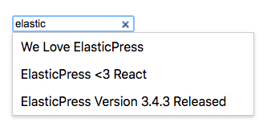
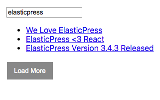

# ElasticPress React

> ElasticPress React is a library of React components to supercharge your headless WordPress website with ElasticPress.

[](#support-level) [](https://github.com/10up/elasticpress-react/releases/latest) [](https://github.com/10up/elasticpress-react/blob/develop/LICENSE.md)

> [!CAUTION]
> As of 9 February 2026, this project is archived and no longer being actively maintained.  You should now check for details in https://github.com/10up/headstartwp/blob/8e1f9df5865b7eeba20e69e20ad91145d5aaf784/packages/epio-search/README.md.

## Requirements

* Elasticsearch per [ElasticPress requirements](https://github.com/10up/ElasticPress#requirements).
* WordPress website running [ElasticPress](https://elasticpress.io).

## Installation

To install ElasticPress React, simply install via npm:

```
npm install @10up/elasticpress-react --save
```

You will need an Elasticsearch instance and a WordPress website running [ElasticPress](https://elasticpress.io).

## Components

### ElasticPressProvider
You must wrap your application with `ElasticPressProvider` in order to use the ElasticPress components.

```js
	<ElasticPressProvider
		node="http://elasticpress.test/__elasticsearch"
		indexName="elasticpresstest-post-1"
	>
		{/* ElasticPress Components */}
	</ElasticPressProvider>
```

### Autosuggest

This component outputs a search field that when typed in will autosuggest results to the user.

```js
import { AutosuggestField } from '@10up/elasticpress-react';

const MyComponent = () => (
	<>
		<p>Here is my fancy new component.</p>

		<p>Here's a search input with autosuggest:</p>

		<ElasticPressProvider
				node="http://elasticpress.test/__elasticsearch"
				indexName="elasticpresstest-post-1"
				loadInitialData={false}
			>
				<AutosuggestField />
			</ElasticPressProvider>
	</>
);
```

#### Screenshot



### Related Content

This component outputs content related to a post.

```js
import { RelatedContent } from '@10up/elasticpress-react';

const MyComponent = () => (
	<>
		<p>Here is my fancy new component.</p>

		<p>Here is some related content to post 5:</p>

		<RelatedContent
			wpApiRoot="https://mysite.com/wp-json"
			postId="5"
		/>
	</>
);
```

### Search and Post Results

```js
import { PostContextProvider, SearchField, Posts } from '@10up/elasticpress-react';

const MyComponent = () => {
	// Make sure to wrap your components with the provider.
	return (
		<ElasticPressProvider
			node="http://elasticpress.test/__elasticsearch"
			indexName="elasticpresstest-post-1"
		>
			<div>
				<SearchField />
			</div>

			<div>
				<Posts />
			</div>
		</ElasticPressProvider>
	);
};
```

#### Screenshot


## Support Level

**Archived:** This project is no longer maintained by 10up. We are no longer responding to Issues or Pull Requests unless they relate to security concerns. We encourage interested developers to fork this project and make it their own!

## Changelog

A complete listing of all notable changes to ElasticPress React components are documented in [CHANGELOG.md](https://github.com/10up/elasticpress-react/blob/develop/CHANGELOG.md).

## Contributing

Please read [CODE_OF_CONDUCT.md](https://github.com/10up/elasticpress-react/blob/develop/CODE_OF_CONDUCT.md) for details on our code of conduct, [CONTRIBUTING.md](https://github.com/10up/elasticpress-react/blob/develop/CONTRIBUTING.md) for details on the process for submitting pull requests to us, and [CREDITS.md](https://github.com/10up/elasticpress-react/blob/develop/CREDITS.md) for a listing of maintainers of, contributors to, and libraries used by ElasticPress React components.

## Like what you see?

<a href="http://10up.com/contact/"></a>
